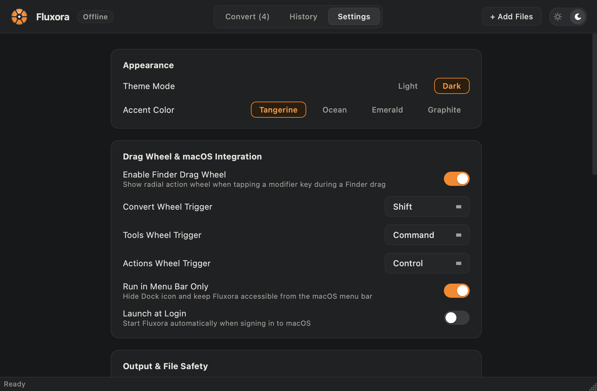

# Fluxora

**Fluxora – Intelligent File Conversion & Productivity Suite** for macOS. Offline batch file conversion, compression, quick tools, and cursor radial drag utilities.

[](https://github.com/SahilMore06/Fluxora/actions/workflows/ci.yml)
[](https://github.com/SahilMore06/Fluxora/releases/latest)
[-222325)](#download-and-installation)
[](pyproject.toml)
[](LICENSE)

[Showcase](#launch-showcase) · [Why Fluxora](#why-fluxora) · [Download](#download-and-installation) · [Drag Wheel](#finder-drag-wheel) · [Desktop App](#desktop-window-and-onboarding) · [Quick Tools](#quick-tools-and-native-actions) · [Supported Formats](#supported-formats-and-backends) · [CLI](#command-line-interface) · [Architecture](#architecture-and-project-layout)

---

Fluxora pairs a PySide6 batch desktop window and command-line tool with a non-activating radial overlay that opens beneath your cursor while dragging files in Finder. Conversions and edits execute locally on your Mac through Pillow, FFmpeg, ImageMagick, Ghostscript, Pandoc, LibreOffice, and 7-Zip with zero network access, telemetry, or Accessibility permission prompts ([Privacy Policy](PRIVACY.md)).

<a id="launch-showcase"></a>


---


## Why Fluxora

| Common Mac File Friction | How Fluxora Handles It |
| :--- | :--- |
| **Cloud Upload Privacy Risks** | Contracts, receipts, media, and documents process locally on your Mac with zero network requests or accounts. |
| **Daily Caps, Wait Queues & Watermarks** | Unlimited batch conversions and tools offline under the MIT license. |
| **Losing Finder Context** | Summon a cursor-centered radial wheel while dragging any file (`Shift`, `Command`, `Control`) instead of opening browser tabs or hunting through `~/Downloads`. |
| **Accessibility Permission Prompts** | Uses passive Quartz modifier taps (`CGEventTap`) and `NSDragPboard` change counts without global Accessibility permissions or keystroke logging. |
| **Destructive Overwrites** | Source files stay untouched and existing targets append numeric increments (`report (1).pdf`) unless overwrite is enabled in Settings. |

## Download and Installation

### Option 1: Download Pre-Built macOS App

Download the latest packaged application bundle directly from [GitHub Releases](https://github.com/SahilMore06/Fluxora/releases/latest):

| Package | Direct Download | Target | Notes |
| :--- | :--- | :--- | :--- |
| **macOS Disk Image** | [Download `Fluxora.dmg`](https://github.com/SahilMore06/Fluxora/releases/latest/download/Fluxora.dmg) | macOS 13+ | Drag `Fluxora.app` into `/Applications` |
| **Standalone ZIP** | [Download `Fluxora.app.zip`](https://github.com/SahilMore06/Fluxora/releases/latest/download/Fluxora.app.zip) | macOS 13+ | Extract and move `Fluxora.app` into `/Applications` |
| **Checksums** | [View `SHA256SUMS.txt` & Release Notes](https://github.com/SahilMore06/Fluxora/releases/latest) | All builds | Verify downloads via `shasum -a 256` |

#### First-Launch Setup on macOS

1. Move `Fluxora.app` into `/Applications`.
2. Because open-source builds use ad-hoc code signing rather than paid Apple Developer notarization, macOS Gatekeeper prompts on first launch. Open it by right-clicking `Fluxora.app` and selecting **Open**, or run:

   ```bash
   xattr -cr /Applications/Fluxora.app
   ```

3. On first boot, Fluxora plays an interactive starter setup sequence that checks installed local engines, demonstrates Force Touch drag-wheel haptics, and asks you to confirm the offline [Privacy Policy](PRIVACY.md) and [Terms and Conditions](TERMS.md).
4. Python engines (`Pillow`, `pillow-heif`, `pypdf`, `pdf2docx`, `python-pptx`, `openpyxl`, `pandas`, archive/subtitle handlers) work immediately out of the box. Install optional Homebrew packages to unlock video, audio, vector PDF compression, EPUB/DOCX markup, and LibreOffice conversions:

   ```bash
   brew install ffmpeg imagemagick pandoc poppler ghostscript sevenzip
   brew install --cask libreoffice
   ```

### Option 2: Install from Source

Requires macOS 13+ (Apple Silicon or Intel), Python 3.12+, and [Homebrew](https://brew.sh):

```bash
git clone https://github.com/SahilMore06/Fluxora.git && cd Fluxora && ./scripts/setup.sh
```

`scripts/setup.sh` installs the Homebrew conversion tools above, configures `.venv` with Python 3.12, and installs Fluxora in editable mode with test and build dependencies.

Manual virtual environment setup:

```bash
python3 -m venv .venv
source .venv/bin/activate
pip install -e ".[dev]"
```

## Finder Drag Wheel

Begin dragging one or more files or folders in Finder and press a modifier key to open the radial wheel centered at the pointer:

| Modifier Key | Wheel Mode | Available Operations |
| :--- | :--- | :--- |
| `Shift` | **Convert** | Context-filtered target formats compatible with every selected item, expanding into an outer `MORE...` ring when over six formats match |
| `Command` | **Quick Tools** | Format-aware tools (`Compress`, `Resize`, `Rotate`, `Crop`, `Trim`, `Split`, `Merge`, `Metadata`, `To PDF`) |
| `Control` | **macOS Actions** | Native OS actions (`AirDrop`, `Float`, `Copy`, `Move`, `Copy Path`, `Open in Terminal`) |

### Engineering Details

- **Zero Accessibility Permissions**: `MacDragMonitor` polls `NSPasteboard` (`NSDragPboard`) change counts dynamically (10 Hz idle, 60 Hz during primary mouse drags) alongside a passive Quartz `CGEventTap` (`kCGEventFlagsChanged` and key events).
- **Non-Activating Overlay**: The wheel runs inside an `NSWindow` at `NSStatusWindowLevel` across all Spaces and full-screen apps so Finder retains active drag focus.
- **Force Touch Haptics & Audio**: Supported MacBook trackpads receive `NSHapticFeedbackManager` ticks (`alignment` across petal boundaries and theme switches, `level_change` on click and job completion) synchronized with subtle `NSSound` cues.
- **Non-Destructive Defaults**: New files are written next to the source item with incremental numeric suffixes (`report (1).pdf`) unless overwrite or a custom output folder is enabled in Settings.

## Desktop Window and Onboarding

### Batch Queue, Encoding Controls, and History

Drop individual files or nested folders into the main window to assign per-file or bulk output formats (`Convert all to`), tune JPEG/WebP/HEIC/AVIF quality, H.264/VP9 CRF and video resolution (`original`, `1080p`, `720p`, `480p`), audio bitrate, or PDF render DPI, and execute conversions concurrently on a `QThreadPool`.


Completed conversions appear in the **History** tab with single-click `Reveal in Finder`, `Copy Path`, and `Open in Terminal` actions. An animated menu-bar status popover (`tray_popover.py`) keeps drag monitoring status, quick drop, and app toggles accessible from the macOS menu bar.



### Theming, Accessibility, and First-Boot Tour

- **Light & Dark Design Tokens**: Centralized token stylesheets in `filetool/ui/styles.py` meet WCAG AA text contrast across Light and Dark modes with four accent presets (`Tangerine`, `Ocean`, `Emerald`, `Graphite`).
- **Reduced Motion**: Animations and transitions respect `prefers-reduced-motion` system settings.
- **Starter Tour & Settings Validation**: Settings validates duplicate trigger modifiers and missing custom output directories, manages `Launch at Login` via a user LaunchAgent, inspects local binary health, and lets you replay the animated starter setup or review Privacy and Terms anytime.

## Quick Tools and Native Actions

| Category | Action | Backend / Behavior |
| :--- | :--- | :--- |
| **Compression** | `Compress` | Images via Pillow quality optimization; video via FFmpeg H.264 CRF; PDFs via Ghostscript (`/ebook`, `/screen`, `/printer`) |
| **Geometry** | `Resize`, `Rotate`, `Crop` | Aspect-preserving dimension scaling and margin crop via Pillow; image and multi-page PDF rotation via Pillow and `pypdf` |
| **Time & Pages** | `Trim`, `Split`, `Merge` | Media clipping and concatenation via `ffmpeg`; PDF page splitting and multi-file merge via `pypdf` |
| **Privacy Tool** | `Metadata` Strip | Removes EXIF, GPS, IPTC, and container metadata tags via Pillow and `ffmpeg -map_metadata -1` |
| **macOS Actions** | `AirDrop`, `Float`, `Copy`, `Move`, `Path`, `Terminal` | Native `NSSharingService` AirDrop sheet, always-on-top floating preview window, Finder pasteboard copy/move, clipboard path copy, and Terminal launch |
| **Finder Service** | `Convert with Fluxora` | Installs as a macOS Quick Action in `~/Library/Services` |

## Supported Formats and Backends

Fluxora registers **266 conversion pairs** across **47 input extensions**, **39 output formats**, and **9 categories**.

| Category | Pairs | Input Extensions | Output Formats | Local Backends |
| :--- | :---: | :--- | :--- | :--- |
| **Images** | 72 | `avif`, `bmp`, `heic`, `jpeg`, `jpg`, `png`, `svg`, `tif`, `tiff`, `webp` | `avif`, `bmp`, `heic`, `jpg`, `pdf`, `png`, `tiff`, `webp` | Pillow, `pillow-heif`, ImageMagick (`magick`), macOS `sips` |
| **Audio** | 63 | `aif`, `aiff`, `flac`, `m4a`, `mp3`, `ogg`, `opus`, `wav`, `wma` | `aiff`, `flac`, `m4a`, `mp3`, `ogg`, `opus`, `wav`, `wma` | FFmpeg (`ffmpeg`, `ffprobe`) |
| **Video** | 49 | `avi`, `gif`, `mkv`, `mov`, `mp4`, `webm`, `wmv` | `avi`, `gif`, `mkv`, `mov`, `mp3`, `mp4`, `webm`, `wmv` | FFmpeg (`ffmpeg`) |
| **Documents** | 31 | `docx`, `epub`, `html`, `md`, `rtf`, `txt` | `docx`, `epub`, `html`, `md`, `pdf`, `rtf`, `txt` | Pandoc, LibreOffice (`soffice`) |
| **Spreadsheets** | 21 | `csv`, `ods`, `tsv`, `xls`, `xlsx` | `csv`, `ods`, `pdf`, `tsv`, `xlsx` | `pandas`, `openpyxl`, LibreOffice (`soffice`) |
| **Archives** | 12 | `gz`, `rar` (extract), `tar`, `tgz`, `zip` | `gz`, `tar`, `zip` | 7-Zip (`7zz`), Python `zipfile` and `tarfile` |
| **PDF** | 8 | `pdf` | `docx`, `epub`, `jpg`, `md`, `png`, `pptx`, `txt`, `xlsx` | `pypdf`, `pdf2docx`, `python-pptx`, Poppler (`pdftoppm`, `pdftotext`), Pandoc |
| **Slides** | 6 | `ppt`, `pptx` | `jpg`, `pdf`, `png` | LibreOffice (`soffice`), Poppler (`pdftoppm`) |
| **Subtitles** | 4 | `srt`, `vtt` | `srt`, `txt`, `vtt` | Built-in Python subtitle parser |

### External Binary Lookup Order

`ToolResolver` searches the packaged bundle (`Contents/Resources/bin`), repo `resources/bin`, Apple Silicon Homebrew (`/opt/homebrew/bin`), Intel Homebrew (`/usr/local/bin`), `/usr/bin`, and `/Applications/LibreOffice.app/Contents/MacOS`, so standalone `.app` launches from Finder resolve tools reliably even without an interactive shell `$PATH`.

## Command-Line Interface

### Desktop App Options

```bash
# Standard launch (triggers first-boot starter animation and Terms acceptance if unset)
.venv/bin/python app.py

# Start minimized in the macOS menu bar
.venv/bin/python -m filetool.app --daemon

# Replay the animated starter sequence and haptic wheel intro
.venv/bin/python app.py --intro

# Reset saved onboarding acceptance state before launch
.venv/bin/python app.py --reset-onboarding
```

### Batch CLI Conversion

```bash
# Convert a single file with explicit quality settings
fluxora photo.heic --to jpg --quality 90 --out-dir ./converted

# Transcode video with target CRF and resolution scaling
fluxora clip.mov --to mp4 --crf 22 --resolution 1080p

# Show compatible output formats for a file and verify tool availability
fluxora report.pdf --list-formats

# Inspect local CLI dependency health
fluxora --check-deps
```

Available conversion flags: `--to`, `--out-dir`, `--overwrite`, `--quality` (1 to 100), `--dpi` (default 300), `--bitrate` (`128k`/`192k`/`256k`/`320k`), `--crf` (0 to 51), `--resolution` (`original`, `1080p`, `720p`, `480p`), `--list-formats`, and `--check-deps`. When calling without activating `.venv`, substitute `.venv/bin/python -m filetool.cli`.

### Finder Quick Action & Packaging

```bash
# Install "Convert with Fluxora" into ~/Library/Services
./scripts/install_quick_action.sh

# Build signed Fluxora.app, Fluxora.app.zip, Fluxora.dmg, and SHA256SUMS.txt
./scripts/build_app.sh
```

## Privacy and Safety Guarantees

- **Zero Outbound Network Calls**: No updates, analytics, crash telemetry, cookies, or account logins exist in the codebase ([Privacy Policy](PRIVACY.md)).
- **Subprocess Safety**: External binaries run strictly with argument arrays (`shell=False`) and clean temporary staging directories deleted after each job.
- **Local Persistence**: Preferences store locally in macOS `QSettings` (`Fluxora` / `Fluxora`) and logs write to `~/Library/Logs/Fluxora/fluxora.log`. Optional `Launch at Login` writes only `~/Library/LaunchAgents/com.fluxora.app.plist`.

## Architecture and Project Layout

Detailed technical notes and visual system maps live in [docs/ARCHITECTURE.md](docs/ARCHITECTURE.md):

- [System Architecture Diagram](docs/diagrams/filetool_architecture.svg)
- [Radial Drag and Drop Flow](docs/diagrams/filetool_interaction_flow.svg)

```text
filetool/
  app.py                Menu-bar coordinator, onboarding gate, drag polling, and CLI flags
  cli.py                Command-line conversion and dependency diagnostics (`fluxora` / `filetool`)
  core/
    deps.py             Local CLI resolver across app bundles, Homebrew, and macOS paths
    image_ops.py        Non-destructive image compression and resize helpers
    legal.py            Bundled offline Privacy Policy and Terms & Conditions renderer
    registry.py         Format compatibility graph and engine lookup (`266` pairs)
    runner.py           `QThreadPool` parallel job execution with progress and cancellation
    utils.py            `shell=False` subprocess runner and unique output path resolver
    engines/            Adapters for archives, images, media, office, pandoc, pdf, sheets, subtitles
    tools/              Compress, crop, merge, metadata strip, resize, split, and trim
  platform/
    mac_actions.py      AirDrop, floating preview, clipboard/Finder actions, LaunchAgent, haptics, sound
    mac_drag_monitor.py Passive Quartz `CGEventTap` + `NSDragPboard` drag state machine
    mac_window.py       Non-activating `NSStatusWindowLevel` overlay bridge
  ui/
    components.py       Animated emblem, vector icons, Force Touch switches, URL helpers
    dropzone.py         Recursive file and folder drop target
    history_panel.py    Completed jobs list with Reveal, Copy Path, and Terminal actions
    job_list.py         Conversion queue rows and stderr diagnostics viewer
    main_window.py      Primary desktop window (`Convert`, `History`, `Settings`)
    onboarding.py       Starter install animation, haptic wheel sandbox, and legal consent
    options_panel.py    Quality, CRF, resolution, bitrate, and DPI controls
    settings_page.py    Persistent `QSettings`, validation, accent swatches, and dependency view
    styles.py           WCAG AA Light/Dark design tokens and QSS generator
    tray_popover.py     Animated macOS menu-bar status card and quick-drop actions
    wheel/              Tangerine-style radial geometry, painter, springs, and overlay window
scripts/                Homebrew setup, PyInstaller `.dmg`/`.zip` builder, Quick Action installer
tests/                  Pytest suite across engines, CLI, dependencies, drag monitor, wheel, and UI
docs/                   Architecture docs, SVG/HTML system diagrams, and showcase captures
```

## Testing and Contributing

Run the full test suite sequentially (so headless `soffice` conversions do not contend on LibreOffice user-profile locks):

```bash
.venv/bin/pytest -v
```

Run headless without a Cocoa display session:

```bash
QT_QPA_PLATFORM=offscreen .venv/bin/pytest -v
```

See [CONTRIBUTING.md](CONTRIBUTING.md), [CHANGELOG.md](CHANGELOG.md), [SECURITY.md](SECURITY.md), [CODE_OF_CONDUCT.md](CODE_OF_CONDUCT.md), [PRIVACY.md](PRIVACY.md), and [TERMS.md](TERMS.md) for contributor workflows, release notes, security practices, and policy terms.

If Fluxora saves you time on macOS, starring the repository or opening bug reports and format requests in [GitHub Issues](https://github.com/SahilMore06/Fluxora/issues) helps prioritize future converters and releases.

## License

Released under the [MIT License](LICENSE).
