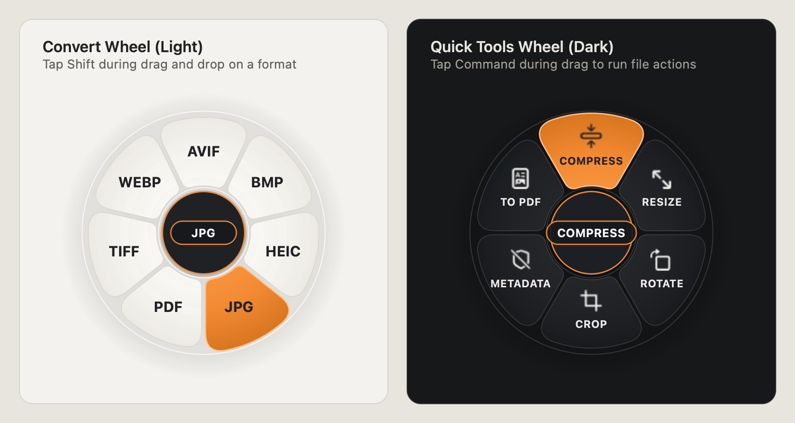
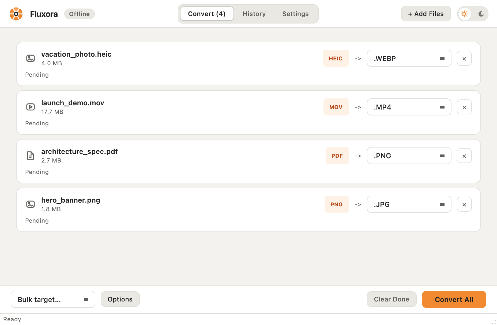

# FileTool

Offline file conversion, compression, and quick file utilities for macOS. FileTool pairs a PySide6 batch desktop window and CLI with a radial drag wheel that follows your cursor during Finder drags.

Everything runs locally on your Mac through Pillow, FFmpeg, ImageMagick, Ghostscript, Pandoc, LibreOffice, and 7-Zip. Nothing is uploaded ([privacy guarantee](PRIVACY.md)).

**Quick start on macOS:**

```bash
git clone https://github.com/SahilMore06/FileTool.git && cd FileTool && ./scripts/setup.sh
```



## Finder drag wheel

Drag one or more files in Finder and tap a modifier key to open the overlay centered on the cursor:

- `Shift` opens the Convert wheel for compatible target formats
- `Command` opens Quick Tools (compress, resize, rotate, crop, trim, split, merge PDF, strip EXIF/metadata)
- `Control` opens macOS Actions (AirDrop, floating preview, copy, move, copy path, open in Terminal)

Drag detection reads `NSDragPboard` change counts while monitoring passive `CGEventTap` modifier events, so it works without Accessibility permissions. The overlay uses a non-activating `NSWindow` at `NSStatusWindowLevel` across all Spaces and full-screen apps without stealing focus from Finder. Existing files are preserved by numeric suffixing (`name (1).ext`) unless overwrite is turned on in Settings.

## Desktop window and theming

Drop files or folders into the desktop app to set individual or bulk target formats, adjust image quality, video CRF and resolution, audio bitrate, or PDF DPI, and review past conversions in History with direct Finder reveal, path copy, and terminal shortcuts.



The Settings page saves preferences in `QSettings`, lets you switch between Light and Dark themes with four accent presets (Tangerine, Ocean, Emerald, Graphite), configures trigger keys and LaunchAgent login startup, and lists local external tools.


## Supported formats and tools

FileTool registers 266 conversion pairs across 47 input extensions and 39 output formats.

| Category | Formats | Backend |
| :--- | :--- | :--- |
| Images | JPG, JPEG, PNG, WebP, HEIC, AVIF, TIFF, BMP, SVG (input) to PDF / raster images | Pillow, `pillow-heif`, ImageMagick (`magick`) |
| Video | MP4, MOV, MKV, WebM, AVI, WMV, GIF | FFmpeg (`ffmpeg`, `ffprobe`) |
| Audio | MP3, M4A, WAV, FLAC, OGG, Opus, AIFF, AIF, WMA | FFmpeg (`ffmpeg`) |
| Documents | PDF, DOCX, MD, TXT, EPUB, HTML, RTF | Pandoc, `pypdf`, `pdf2docx`, `pdftotext`, `pdftoppm` |
| Slides and sheets | PPT, PPTX to PDF / PNG / JPG; XLSX, XLS, ODS, CSV, TSV to XLSX / ODS / CSV / TSV / PDF | LibreOffice (`soffice`), `pdftoppm`, `pandas`, `openpyxl` |
| Subtitles | SRT, VTT, TXT | Built-in Python parser |
| Archives | ZIP, TAR, GZ, TGZ, RAR (extract) | 7-Zip (`7zz`), Python `zipfile` and `tarfile` |

## Setup

### Requirements

- macOS (Apple Silicon or Intel)
- Python 3.12+
- Homebrew tools for full format coverage:

```bash
brew install ffmpeg imagemagick ghostscript pandoc poppler sevenzip
brew install --cask libreoffice
```

### Installation

```bash
git clone https://github.com/SahilMore06/FileTool.git
cd FileTool
./scripts/setup.sh
```

`scripts/setup.sh` installs missing Homebrew tools, creates `.venv`, and installs the package in editable mode with dev dependencies.

Manual editable setup:

```bash
python3 -m venv .venv
source .venv/bin/activate
pip install -e ".[dev]"
```

## Usage

### Desktop app and menu-bar daemon

Launch the window:

```bash
.venv/bin/python app.py
```

Or start directly in menu-bar background mode:

```bash
.venv/bin/python -m filetool.app --daemon
```

### Command-line interface

```bash
# Convert a single file
filetool sample.heic --to jpg

# List supported target formats for a file
filetool sample.heic --list-formats

# Check external tool availability
filetool --check-deps
```

When the virtualenv is not activated, call `.venv/bin/python -m filetool.cli` instead of `filetool`.

### Finder Quick Action and app bundle

Install the "Convert with FileTool" Services entry in Finder:

```bash
./scripts/install_quick_action.sh
```

Build a standalone macOS `.app` bundle with PyInstaller:

```bash
./scripts/build_app.sh
```

## Project layout

```text
filetool/
  app.py                Menu-bar tray icon, drag monitor loop, and window coordinator
  cli.py                CLI entry point (`filetool`)
  core/
    deps.py             External binary resolver and health check
    image_ops.py        Same-format resize and compress operations
    registry.py         Format graph and converter lookup
    runner.py           QThreadPool batch conversion runner
    utils.py            Subprocess wrapper and safe output naming
    engines/            Format adapters (images, media, office, pdf, pandoc, spreadsheets, subtitles, archives)
    tools/              Compress, resize, crop, trim, split, merge, metadata
  platform/
    mac_actions.py      AirDrop, floating preview, clipboard/Finder actions, login item, haptics, sound, notifications
    mac_drag_monitor.py Quartz CGEventTap + NSDragPboard drag state machine
    mac_window.py       Non-activating overlay NSWindow setup
  ui/
    actions.py          Finder Reveal, Copy Path, and Open in Terminal helpers
    components.py       Logo emblem, vector icons, switches, shared URL helpers
    dropzone.py         Recursive folder/file drop target
    history_panel.py    Completed jobs table with Reveal, Copy Path, and Terminal actions
    job_list.py         Conversion queue rows and error log dialog
    main_window.py      Single-window converter (Convert, History, Settings)
    options_panel.py    Quality, CRF, resolution, bitrate, and DPI controls
    settings_page.py    Persistent settings, theme/accent swatches, dependency status
    styles.py           Light/Dark design tokens and QSS builder
    tray_popover.py     Animated macOS menu-bar status card and quick-drop actions
    wheel/              Drag wheel geometry, painter, and overlay window
scripts/                Setup, PyInstaller build, and Finder Quick Action installer
tests/                  Pytest suite across core engines, CLI, drag monitor, and UI
docs/                   Architecture notes, SVG/HTML system diagrams, and UI screenshots
```

System design notes and diagrams live in [docs/ARCHITECTURE.md](docs/ARCHITECTURE.md). Contribution rules are in [CONTRIBUTING.md](CONTRIBUTING.md), and the offline data guarantee is in [PRIVACY.md](PRIVACY.md).

## Testing

```bash
.venv/bin/pytest -v
```

For headless runs without Cocoa display access:

```bash
QT_QPA_PLATFORM=offscreen .venv/bin/pytest -v
```

Run tests sequentially rather than in parallel processes so LibreOffice (`soffice --headless`) avoids user-profile lock contention.

## License

MIT license. See [LICENSE](LICENSE).
