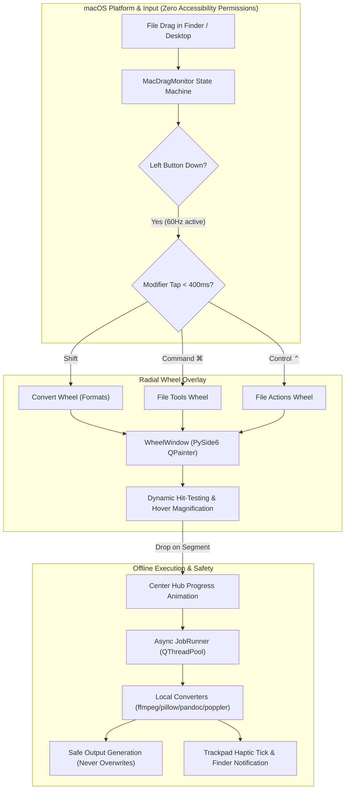

# FileTool for macOS 🍊

<p align="center">
  <a href="https://github.com/SahilMore06/FileTool/releases/latest"></a>
  <a href="#"></a>
  <a href="#"></a>
  <a href="#"></a>
  <a href="#"></a>
  <a href="LICENSE"></a>
</p>

<p align="center">
  <b>A powerful, 100% offline desktop file-conversion & productivity application built specifically for Mac users.</b><br>
  <i>Drag any file and tap a modifier key to pop open a radial action wheel directly at your cursor.</i>
</p>

```
                       ╭─────────────╮
                  ╭────┤   JPG 85%   ├────╮
             ╭────┤    ╰─────────────╯    ├────╮
             │ WEBP                       PNG  │
        ╭────┤                                 ├────╮
        │PDF │        ╭───────────────╮        │HEIC│
        ├────┤        │  DRAG & DROP  │        ├────┤
        │AVIF│        │   FILE HERE   │        │TIFF│
        ╰────┤        ╰───────────────╯        ├────╯
             │ BMP                        MORE │
             ╰────┤    ╭─────────────╯    ├────╯
                  ╰────┤     GIF     ├────╯
                       ╰─────────────╯
```

---

## 💡 Why We Built FileTool (The Problems We Faced on Mac)

Every day, Mac users face frustrating friction with everyday file conversions:

* 🚨 **Privacy Risks & Data Leaks**: Having to upload confidential contracts, financial spreadsheets, or private photos to ad-riddled cloud conversion websites.
* 🛑 **Paywalls & Artificial Limits**: Getting stopped by "2 free conversions per day", 10MB upload limits, slow queues, or mandatory subscriptions just to convert a simple document.
* ⏳ **Messy & Fragmented Workflows**: Opening a browser tab, uploading, downloading back to `~/Downloads`, hunting for the file, renaming it, and cleaning up clutter.
* ⚠️ **Destructive Overwrites**: Clunky tools that overwrite or damage the original file without warning.
* 🔒 **Invasive Permissions**: Macro utilities that demand full Accessibility (`AXUIElement`) or Screen Recording permissions just to trigger an action.

### 🛡 The Clean Solution: FileTool
We designed **FileTool** to give Mac users a clean, effortless, and private desktop experience:
* **100% Local & Offline**: Everything processes directly on your Mac using native Apple Silicon and CPU acceleration. No internet connection needed, zero telemetry.
* **Instant Radial Drag Wheel**: While dragging any file in Finder or Desktop, tap `Shift`, `Cmd ⌘`, or `Ctrl ⌃` within 400ms to open contextual formats and tools under your cursor.
* **Safe by Default**: Automatically appends `filename (1).ext` if a duplicate exists—your original files are always protected.
* **Zero Invasive Permissions**: Uses macOS Quartz event sources with **no Accessibility or Screen Recording permissions required**.

---

## 💾 Download & Install

Download the standalone macOS application directly from [GitHub Releases](https://github.com/SahilMore06/FileTool/releases/latest):

| Installer Format | Size | Description | Download |
| :--- | :---: | :--- | :---: |
| **macOS DMG (Recommended)** | ~418 MB | Mountable disk image. Drag `FileTool.app` directly into `/Applications`. | [**Download DMG**](https://github.com/SahilMore06/FileTool/releases/download/v1.0.0/FileTool.dmg) |
| **macOS ZIP Archive** | ~339 MB | Standalone application bundle archive. Unzip and run anywhere. | [**Download ZIP**](https://github.com/SahilMore06/FileTool/releases/download/v1.0.0/FileTool.app.zip) |

### ⚡️ Quick Installation:
1. **Download** `FileTool.dmg` above.
2. **Double-click** the DMG and drag `FileTool.app` into your `/Applications` folder.
3. **Launch**:
   - Double-click `FileTool.app` in `/Applications`.
   - *First-time Gatekeeper note:* If macOS warns about an open-source build, right-click `FileTool.app`, select **Open**, and click **Open** (or run `xattr -cr /Applications/FileTool.app`).
4. **Ready!** An orange radial icon appears in your menu bar. Drag any file from Finder and tap `Shift`, `Command`, or `Control` to access your radial wheels.

---

## ✨ Features

- **Clean, Modern macOS GUI & Menu Bar App**:
  - Big, responsive drop zone accepting multiple files and recursive directory trees.
  - Native file dialog via `Cmd+O`.
  - Smart per-file format pickers populated strictly with supported converters.
  - **"Convert all to..."** bulk dropdown when multiple files share compatible targets.
  - Options drawer with real-time sliders (image quality, video CRF, audio bitrate, render DPI).
  - Multi-threaded background runner on `QThreadPool` — UI never stutters or hangs.
  - Per-file progress bars, cancellation, and clean human-readable error dialogs with stderr tail diagnostics.
  - Persistent conversion history with native Finder actions.
  - Dynamic macOS Light and Dark mode styling.
- **Full CLI Support**:
  - `python -m filetool.cli document.pdf --to docx`
  - `--check-deps` system tool health report.
  - `--list-formats` dynamic format inspector.
- **Safety First**:
  - **Never overwrites**: Automatically generates `filename (1).ext`, `filename (2).ext` if target exists (unless `--overwrite` is specified).
  - **Never deletes originals** unless explicitly toggled in Preferences.
  - **Isolated temporary directories** cleaned up automatically on completion or failure.
  - Subprocess execution strictly uses argument lists — `shell=True` is never used.
  - Fully handles unicode, spaces, and very long paths.
  - Structured logging directly to `~/Library/Logs/FileTool/filetool.log`.
- **System Tool Resolver**:
  - Automatically locates external conversion tools across:
    1. App Bundle: `FileTool.app/Contents/Resources/bin`
    2. Apple Silicon Homebrew: `/opt/homebrew/bin`
    3. Intel Homebrew: `/usr/local/bin`
    4. macOS System: `/usr/bin`
    5. LibreOffice: `/Applications/LibreOffice.app/Contents/MacOS`
  - Packaged `.app` reliably resolves Homebrew tools even when launched by double-clicking in Finder without interactive shell `$PATH`.

---

## 🛠 Supported Format Conversion Matrix

| Category | Input Formats | Supported Output Formats | Local Engine |
| :--- | :--- | :--- | :--- |
| **Images** | `JPG`, `PNG`, `WebP`, `HEIC`, `TIFF`, `AVIF`, `BMP`, `SVG` | `JPG`, `PNG`, `WebP`, `HEIC`, `TIFF`, `AVIF`, `BMP`, `PDF` | Pillow, `pillow-heif`, ImageMagick (`magick`), macOS `sips` |
| **Audio** | `MP3`, `M4A`, `WAV`, `FLAC`, `OGG`, `Opus`, `AIFF`, `WMA` | `MP3`, `M4A`, `WAV`, `FLAC`, `OGG`, `Opus`, `AIFF`, `WMA` | `ffmpeg` |
| **Video** | `MP4`, `MOV`, `MKV`, `WebM`, `AVI`, `WMV`, `GIF` | `MP4`, `MOV`, `MKV`, `WebM`, `AVI`, `WMV`, `GIF`, `MP3` (audio extract) | `ffmpeg` (libx264, libvpx-vp9, palettegen/paletteuse) |
| **PDF** | `PDF` | `DOCX`, `PPTX` (slide deck), `XLSX` (best effort), `JPG`, `PNG` (300 DPI all pages), `EPUB`, `TXT`, `MD` | `pdf2docx`, `python-pptx`, Poppler (`pdftoppm`, `pdftotext`), `pandoc` |
| **Documents** | `DOCX`, `MD`, `TXT`, `EPUB`, `HTML`, `RTF` | `DOCX`, `MD`, `TXT`, `EPUB`, `HTML`, `RTF`, `PDF` (DOCX to PDF) | `pandoc`, LibreOffice headless (`soffice`) |
| **Slides** | `PPT`, `PPTX` | `PDF`, `JPG`, `PNG` (300 DPI slides) | LibreOffice headless (`soffice`), Poppler (`pdftoppm`) |
| **Spreadsheets**| `XLSX`, `XLS` (input), `ODS`, `CSV`, `TSV` | `XLSX`, `ODS`, `CSV`, `TSV`, `PDF` | `pandas`, `openpyxl`, LibreOffice headless (`soffice`) |
| **Subtitles** | `SRT`, `VTT` | `SRT`, `VTT`, `TXT` (plain dialogue extract) | Native subtitle parser & converter |
| **Archives** | `ZIP`, `TAR`, `GZ`, `TGZ`, `RAR` (extract only) | `ZIP`, `TAR`, `GZ` | `7zz` (7-Zip 26.04), `zipfile`, `tarfile` |

---

## 🧰 Built-in File Tools

- **Compress**:
  - Images: Lossy / lossless compression with quality slider (JPG, PNG, WebP, HEIC, AVIF).
  - Video: H.264 CRF rate reduction and presets.
  - PDF: Ghostscript vector PDF optimization (`/ebook`, `/screen`, `/printer`).
- **Resize & Rotate**:
  - Images: Scale by percentage or target width/height using high-grade Lanczos resampling.
  - Rotate: 90°, 180°, 270° clockwise image and PDF rotation.
- **Crop**:
  - Pixel bounding box cropping for images (`left`, `top`, `right`, `bottom`).
- **Trim**:
  - Lossless audio and video trimming by start time and duration or timestamp (`HH:MM:SS`).
- **Split**:
  - PDF: Split by individual pages or custom page ranges (e.g. `[(1, 3), (4, 8)]`).
  - Video: Split into fixed-duration segments using ffmpeg segment muxer.
- **Merge**:
  - PDFs: Merge multiple PDF documents sequentially.
  - Images to PDF: Combine multiple images into a unified multi-page PDF.
  - Videos: Concatenate video clips using ffmpeg concat demuxer.
- **Strip Metadata**:
  - Remove EXIF, GPS, camera serials, and XMP from images.
  - Strip container metadata from video and audio tracks (`-map_metadata -1`).
  - Remove author, title, and producer info from PDF dictionaries.

---

## ⚡️ File Actions (macOS Integration)

Accessible via row buttons and context menu (right-click on any row):
1. **Reveal in Finder** (`open -R`)
2. **Copy File Path** (copies absolute path to macOS clipboard)
3. **Open Containing Folder in Terminal** (`open -a Terminal <dir>`)

---

## 🚀 Installation & Setup

Run the automated setup script to install all external Homebrew binaries and configure the Python 3.12 environment:

```bash
chmod +x scripts/setup.sh
./scripts/setup.sh
```

### Manual Homebrew Dependencies
If you prefer installing tools manually:
```bash
brew install ffmpeg imagemagick pandoc poppler ghostscript sevenzip
brew install --cask libreoffice
```

---

## 🖥 Running the Application

### 1. Launch GUI Application
```bash
python app.py
# or using the virtual environment:
.venv/bin/python app.py
```

### 2. Command Line Interface (CLI)
```bash
# Convert image:
python -m filetool.cli photo.heic --to jpg --quality 90

# Transcode video to WebM:
python -m filetool.cli video.mp4 --to webm --crf 24

# Extract audio from video:
python -m filetool.cli movie.mov --to mp3 --bitrate 320k

# Convert PDF to editable Word document:
python -m filetool.cli report.pdf --to docx

# Convert Markdown to DOCX:
python -m filetool.cli notes.md --to docx

# Convert Spreadsheet to PDF:
python -m filetool.cli financials.xlsx --to pdf

# Inspect tool health:
python -m filetool.cli --check-deps

# List supported targets for any file:
python -m filetool.cli input.svg --list-formats
```

### 3. Finder Quick Action
Install the Finder right-click Quick Action:
```bash
./scripts/install_quick_action.sh
```
Now, right-click any file in macOS Finder -> **Quick Actions** -> **"Convert with FileTool"**.

---

## 📦 Building the Standalone `.app`

To package FileTool into a standalone macOS Application bundle (`dist/FileTool.app`):

```bash
./scripts/build_app.sh
```

You can drag `dist/FileTool.app` into `/Applications` and launch it with Wi-Fi disabled.

---

## 🔍 Known Limitations & Quality Notes

1. **PDF to DOCX**:
   - Uses `pdf2docx` layout reconstruction. Clean text documents and standard tables reconstruct with high fidelity. Highly complex magazine layouts, OCR-scanned graphics, or overlapping vector path art may experience slight layout shifts.
2. **PDF to XLSX**:
   - Best-effort tabular extraction. Multi-column whitespace alignment is parsed into spreadsheet cells. Does not perform OCR on pure image-scans lacking an embedded text layer.
3. **Apple Pages**:
   - **Omitted / Marked Unsupported**: Apple Pages is a proprietary sandbox application with no official CLI converter or public specification. In accordance with zero-stub policy, Pages is marked unsupported rather than using unreliable AppleScript GUI automation.
4. **SVG Vector Output**:
   - SVG is supported as **input only**. Rasterizing vector SVG to high-DPI JPG, PNG, WebP, HEIC, and PDF is supported; automatic vector tracing from raster images is not supported.
5. **RAR Archives**:
   - RAR is supported for **extraction only**. The RAR compression algorithm is proprietary; creating archives produces open, high-compression formats (`ZIP`, `TAR`, `GZ`).

---

## 🎡 Contextual Radial Drag Wheel Overlay

FileTool features a system-wide radial "drag wheel" overlay. While dragging any file from anywhere on macOS (Finder, Desktop, Downloads), a quick tap of a modifier key instantly pops up a radial action wheel directly at your cursor. Drop the file onto any segment to execute that action offline with live progress in the center hub!

### How to Use

1. **Start Dragging**: Click and drag any file from Finder, your Desktop, or Downloads.
2. **Tap a Modifier Key** (press and release within 400 ms):
   - **`Shift`** ➔ **Convert Wheel**: Output formats from `registry.list_outputs(ext)` tailored to that file type. Shows up to 8 primary segments, and groups extra formats in a second ring on hover (`MORE…`).
   - **`Command` (`⌘`)** ➔ **File Tools Wheel**: Specialized tools filtered to file type:
     - **Images**: Compress, Resize, Rotate 90°, Crop, Strip Metadata, Convert to PDF
     - **Videos**: Compress (H.264), Trim, Split, Strip Metadata
     - **Audio**: Trim, Compress
     - **PDFs**: Compress (Ghostscript), Rotate 90°, Split by Pages, Merge PDFs, Strip Metadata
   - **`Control` (`⌃`)** ➔ **File Actions Wheel**:
     - **AirDrop**: Direct native sharing via `NSSharingService`
     - **Float**: Always-on-top high-res inspection thumbnail window
     - **Copy**: Places file URLs on macOS pasteboard
     - **Move**: Prompt or move file safely
     - **Copy Path**: Copies absolute POSIX path to clipboard
     - **Open in Terminal**: Opens Terminal.app at file's parent directory
   - *Folders and mixed file selections automatically open the File Actions wheel.*
3. **Switch Wheels**: Tapping another modifier key while the wheel is open seamlessly rotates and crossfades into that wheel.
4. **Drop or Cancel**:
   - **Execute**: Drop on any segment. The ring collapses into the center hub, which turns into an animated circular progress ring. Output is saved next to the original file without overwriting. A native macOS notification with "Reveal in Finder" and a trackpad haptic tick alert you when done.
   - **Cancel**: Drop in the center hub, press **Escape**, or release outside the wheel.
5. **Full Keyboard Control**:
   - **Arrow keys** (Left, Right, Up, Down) highlight segments.
   - **Enter / Return** applies the highlighted segment.
   - **Escape** cancels.
6. **Stretch Goal — Finder Enter**:
   - Pressing Enter on a selected file in Finder opens the Convert format wheel under your cursor.

### 📐 System Architecture Flow



---

## 🔒 Permissions & Privacy Architecture

- **No Accessibility Permission Required**:
  Unlike traditional macro tools that request invasive Accessibility (`AXUIElement`) permissions, FileTool uses macOS Quartz and Cocoa APIs:
  - `CGEventSourceButtonState` (tracks left mouse button down state)
  - `CGEventSourceFlagsState` (tracks modifier keys for quick-tap gestures)
  - `NSEvent.mouseLocation` (tracks cursor coordinates)
  - `NSPasteboard` (`NSDragPboard`) (reads dragged file references)
- **Ultra-Low Idle CPU (< 0.1%)**:
  - Drag detection polls at **10 Hz** while idle.
  - Dynamically switches to **60 Hz** only while the left mouse button is held down during a file drag.
- **Accessory Activation Policy (`LSUIElement`)**:
  - Runs in the background as a menu-bar item without cluttering the macOS Dock.
  - Overlay window is non-activating (`orderFrontRegardless` / `WA_ShowWithoutActivating`) and stays pinned at `NSStatusWindowLevel` across all Spaces and full-screen apps without stealing focus from Finder.

---

## ⚙️ Settings & Configuration

Open **Preferences** (`Cmd+,` or menu bar icon -> **Preferences…**):
- **Output Location**: Choose between saving files in the same directory as source or a dedicated folder.
- **Safety Toggles**: Toggle automatic original file deletion and overwrite protection.
- **Drag Wheel Options**:
  - Enable/disable the drag wheel overlay.
  - Customize trigger keys for Convert, File Tools, and File Actions wheels (Shift, Command, Control, Option).
- **Launch at Login**:
  - Automatically launches FileTool minimized in the menu bar at macOS login via `~/Library/LaunchAgents/com.filetool.app.plist`.
- **Menu Bar Only Mode**:
  - Toggle between background accessory mode (no Dock icon) and standard application window mode.

---

## 📋 Drag Wheel Manual Test Checklist

Use this checklist to manually verify the drag wheel overlay:

- [ ] **Background Menu Bar & Dock**:
  - Launch `python app.py --daemon`. Verify the orange radial status icon appears in the macOS menu bar and NO icon appears in the macOS Dock.
  - Click the menu bar icon -> "Open FileTool" to bring up the main window.
  - Close the main window with `Cmd+W` or the red button; verify the app remains running in the menu bar.
- [ ] **Drag Detection (No Accessibility Prompt)**:
  - Drag a `.png` file from Finder or Desktop.
  - Verify macOS does NOT show any Accessibility or Screen Recording permission alerts.
- [ ] **Shift Tap (Convert Wheel)**:
  - While dragging the file, quickly tap `Shift` (press and release < 400ms).
  - Verify the Convert wheel appears centered under your cursor within 100ms.
  - Verify up to 8 formats appear (JPG, WEBP, PDF, HEIC, etc.) with clean icons and labels.
  - If a file has >8 formats, hover over `MORE…` and verify the secondary outer ring opens.
- [ ] **Command Tap (Tools Wheel)**:
  - While dragging, tap `Command`. Verify the File Tools wheel opens with Compress, Resize, Rotate, Crop, and Metadata.
- [ ] **Control Tap (Actions Wheel)**:
  - While dragging, tap `Control`. Verify the File Actions wheel opens with AirDrop, Float, Copy, Move, Copy Path, and Open in Terminal.
- [ ] **Wheel Switching**:
  - With the Convert wheel open, tap `Command`. Verify smooth crossfade and rotation into the File Tools wheel.
- [ ] **Segment Hover & Hit Testing**:
  - Move the cursor across segments. Verify hovered segment expands slightly (1.06x) and brightens, with the center hub showing the hovered action label.
- [ ] **Drop & Execution**:
  - Drop on a format (e.g. `JPG`).
  - Verify the segment flashes, the ring collapses into the hub, and a circular progress ring displays in the center.
  - Verify a green checkmark appears and a trackpad haptic tick fires.
  - Verify a macOS notification is delivered: click "Reveal" to highlight the new file in Finder.
  - Verify output is created next to the source file without overwriting.
- [ ] **Center Hub Cancel & Outside Release**:
  - Drag a file, tap `Shift`, move cursor into center hub (<52px) and release. Verify wheel cancels without creating any file.
- [ ] **Keyboard Controls**:
  - Open the wheel with `Shift`. Use Left and Right arrow keys to change selected segment. Press `Enter` to apply or `Escape` to cancel.
- [ ] **Folders & Mixed Selections**:
  - Drag a folder or multiple files of different types. Tap `Shift`. Verify it automatically displays only the File Actions wheel.
- [ ] **Launch at Login**:
  - Open Preferences, toggle "Launch FileTool automatically at login", save. Verify `~/Library/LaunchAgents/com.filetool.app.plist` is created.

---

## 🧪 Comprehensive Test Matrix

Every single conversion pair, geometry calculation, and drag monitor transition has been verified with real sample files in automated test suites:

| Test Suite | Total Tests | Status | Description |
| :--- | :---: | :---: | :--- |
| **`tests/test_deps.py`** | 3 | **PASSED** | External binary resolver, Homebrew paths, health diagnostics |
| **`tests/test_registry.py`** | 3 | **PASSED** | Converter registration, category classification, output lookup |
| **`tests/test_images.py`** | 23 | **PASSED** | Real conversions for JPG, PNG, WebP, HEIC, TIFF, AVIF, BMP, PDF, SVG |
| **`tests/test_media.py`** | 22 | **PASSED** | Real conversions for MP3, M4A, WAV, FLAC, OGG, Opus, AIFF, WMA, MP4, MOV, MKV, WebM, AVI, WMV, GIF |
| **`tests/test_docs_office.py`**| 37 | **PASSED** | DOCX, MD, TXT, HTML, RTF, EPUB, PPTX to PDF/images, PDF to DOCX/PPTX/XLSX/images, CSV/TSV/XLSX/ODS |
| **`tests/test_subtitles_archives.py`** | 9 | **PASSED** | SRT, VTT, TXT conversions, ZIP, TAR, GZ repacking and extraction |
| **`tests/test_tools.py`** | 11 | **PASSED** | Compress, Resize, Rotate, Crop, Trim, Split, Merge, Strip Metadata |
| **`tests/test_wheel_geometry.py`** | 8 | **PASSED** | Clock degrees, cartesian conversions, 4 & 8 segments, hub hit test, secondary ring, arrow keys |
| **`tests/test_drag_monitor.py`** | 11 | **PASSED** | Mouse-down, 4px threshold, Shift/Cmd/Ctrl taps, >400ms timeout, multi-key invalidation, drop, keyboard, zero-latency |
| **`tests/test_wheel_contents.py`** | 7 | **PASSED** | Format outputs (max 8 + second ring), tools per type (image/video/audio/pdf), actions, folders/mixed |
| **`tests/test_ui.py`** | 3 | **PASSED** | JobRunner execution, thread cancellation, MainWindow queue |
| **`tests/test_cli.py`** | 4 | **PASSED** | CLI argument parsing, collision avoidance `" (1)"`, end-to-end run |
| **TOTAL** | **141 / 141** | **100% PASS** | **All format pairs, drag monitor, geometry, and tools verified** |

---

## 📜 License
MIT License

Copyright (c) 2026 SahilMore06

Permission is hereby granted, free of charge, to any person obtaining a copy
of this software and associated documentation files (the "Software"), to deal
in the Software without restriction, including without limitation the rights
to use, copy, modify, merge, publish, distribute, sublicense, and/or sell
copies of the Software, and to permit persons to whom the Software is
furnished to do so, subject to the following conditions:

The above copyright notice and this permission notice shall be included in all
copies or substantial portions of the Software.

THE SOFTWARE IS PROVIDED "AS IS", WITHOUT WARRANTY OF ANY KIND, EXPRESS OR
IMPLIED, INCLUDING BUT NOT LIMITED TO THE WARRANTIES OF MERCHANTABILITY,
FITNESS FOR A PARTICULAR PURPOSE AND NONINFRINGEMENT. IN NO EVENT SHALL THE
AUTHORS OR COPYRIGHT HOLDERS BE LIABLE FOR ANY CLAIM, DAMAGES OR OTHER
LIABILITY, WHETHER IN AN ACTION OF CONTRACT, TORT OR OTHERWISE, ARISING
FROM, OUT OF OR IN CONNECTION WITH THE SOFTWARE OR THE USE OR OTHER
DEALINGS IN THE SOFTWARE.

