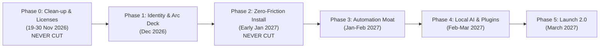
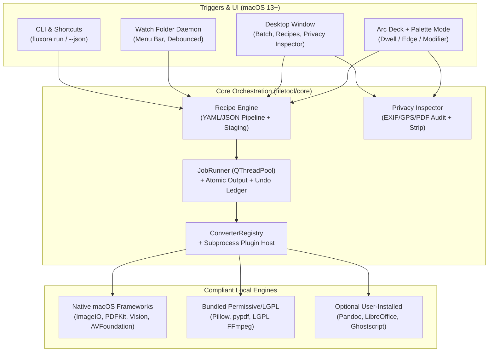

# Fluxora 2.0 — Master Roadmap & Phase 0 Implementation Plan

> **For agentic workers:** REQUIRED SUB-SKILL: Use `superpowers:subagent-driven-development` (recommended) or `superpowers:executing-plans` to implement Phase 0 task-by-task. Phases 1–5 are scoped as sequential sub-plans unlocked at each phase exit gate. Steps use checkbox (`- [ ]`) syntax for tracking.

---

## Start Here: Fluxora 2.0 Explained in Plain English

If you only read one section first, read this one. Here is the entire 16-page PRD boiled down to plain everyday language.

### 1. Where Fluxora Stands Today (v1.1.1) vs Where It Is Going (v2.0)

Fluxora 1.1.1 already converts 266 file pairs offline on Mac, has tests, CI, a CLI, and Docker. The problem is not that the engine is broken — the problem is **three blockers** holding Fluxora back from becoming a trusted, popular open-source product:

| What is wrong in v1.1.1 today | Why it hurts Fluxora | How Fluxora 2.0 fixes it |
| :--- | :--- | :--- |
| **1. Looks & acts too much like Tangerine** | Our wheel geometry (`TANGERINE_INNER_RADIUS`), accent name (`Tangerine`), 3-key scheme (`Shift`/`Cmd`/`Ctrl`), and 6 actions mirror Tangerine closely — legal and brand risk. | Remove every Tangerine reference in Phase 0, then replace the circular wheel with Fluxora's own **Arc Deck** (a semi-circular fan with labeled cards, type-to-filter, and keyboard Palette mode). |
| **2. Hard to install for normal Mac users** | Users hit a Gatekeeper warning (`xattr -cr`) and must install Homebrew (`ffmpeg`, `gs`, `pandoc`, `libreoffice`) in Terminal before audio/video/PDF/Office work. | Bundle or switch to native macOS/compliant engines so 95% of users convert their first file in **under 2 minutes with zero Terminal commands**, plus notarization and a Homebrew Cask. |
| **3. Hidden license traps in our MIT repo** | We already verified `pymupdf` (**AGPL-3.0**) is installed in `.venv` via `pdf2docx`, and Ghostscript (**AGPL**), Pandoc (**GPL**), and Poppler (**GPL**) are invoked externally. Bundling copyleft code inside an MIT binary breaks licenses. | Run a full automated Python + binary license audit, add `THIRD_PARTY_NOTICES.md`, add a CI gate that blocks unknown/unsafe licenses, and swap or separate every copyleft engine cleanly. |

### 2. The Core Big Idea of Fluxora 2.0

**One-line pitch:** *"The open-source macOS file converter you can automate — and prove stays offline."*

Instead of trying to chase a closed-source app feature-for-feature, Fluxora 2.0 wins where closed apps cannot:
1. **Recipes (Pipelines):** Chain steps once (for example: *Convert to JPG -> Resize to 2048px -> Strip GPS/EXIF -> Zip*) and reuse them from the deck, desktop window, CLI, or a folder rule.
2. **Watch Folders:** Drop files into a folder and let Fluxora run a recipe automatically in the background.
3. **Provable Privacy:** A **Privacy Inspector** shows hidden EXIF/GPS/author metadata inside any file before sharing, strips it in one click, and includes a CI test that fails if anyone adds network imports.
4. **Local AI & Plugins:** Add offline Apple Vision OCR (zero model download) plus a second opt-in local AI tool, and let developers build subprocess plugins without forking Fluxora.

### 3. The 6 Phases at a Glance (Nov 2026 – March 2027)



- **Phase 0 — Clean-up (Do First, ~1–2 weeks):** Scrub every `Tangerine` reference in code/docs/website, rename accent to `Amber` with settings migration, audit every Python & binary license (`THIRD_PARTY_NOTICES.md` + CI check), verify real macOS permissions vs README wording, document `resources/` asset provenance, check trademark conflicts, rewrite copy, open P0/P1/P2 GitHub issues.
- **Phase 1 — Identity & Arc Deck (~3–4 weeks):** Design and ship the original **Arc Deck** (semi-circular fan away from screen edge + type-to-filter + keyboard/VoiceOver Palette mode + 0.6s dwell / edge-shelf trigger), switch to 6 intent groups (*Convert*, *Shrink & Fix*, *Combine & Split*, *Protect*, *Share & Organize*, *Recipes*), publish original brand kit.
- **Phase 2 — Zero-Friction Install (~2–3 weeks):** Replace/isolate AGPL/GPL engines (prefer macOS `ImageIO`, `PDFKit`/Quartz, `AVFoundation` or compliant LGPL FFmpeg, make optional copyleft tools user-installed), profile cold start (`<2s`) and idle CPU (`<1%`), ship `universal2` signed/notarized `.dmg` + SBOM + Homebrew Cask.
- **Phase 3 — The Moat (~4–5 weeks):** Build **Recipes** (YAML/JSON + Visual Builder + 4 starter recipes + `fluxora run`), **Watch Folders** (menu-bar daemon with debounce + loop guard), **Privacy Inspector & Proof** (before/after report + CI zero-network test), and **Quick Look Preview + Size Estimate + History Undo/Revert**.
- **Phase 4 — Extend (~3–4 weeks):** Ship **2 offline Local AI tools** (Apple Vision OCR first, plus opt-in transcription or Core ML image tool with checksum verification), **Subprocess Plugin SDK** (`~/Library/Application Support/Fluxora/Plugins`), CLI `--json` + stable exit codes, Finder Quick Action recipes, and Shortcuts support.
- **Phase 5 — Launch 2.0 (~2–3 weeks):** Complete website pages (`Home`, `Download`, `Docs`, `Privacy proof`, `Changelog`, `Roadmap`, `Press kit`), record an original demo video (Arc Deck + Recipe + Watch Folder), set up localization strings (Hindi, Marathi, Spanish), and launch on Show HN, `r/macapps`, `r/opensource`, Product Hunt, and Homebrew.

> [!IMPORTANT]
> **Strict Cut Order if Time Gets Tight (from PRD Section 11):**
> Cut in this order only: **1.** Local AI beyond OCR -> **2.** Plugin API -> **3.** Batch rename -> **4.** Localization.
> **Never cut Phase 0 (Clean-up & Licenses) or Phase 2 (Zero-Friction Install).**

### 4. Five Decisions You Need to Make Before We Go Past Phase 0

1. **Apple Developer Program (\$99/year) for Phase 2 Notarization:** Full Gatekeeper-free install (`D1`) and official Homebrew Cask acceptance require an Apple Developer ID certificate (~\$99/yr). If staying strictly \$0 for now, we can finish Phase 0, Phase 1, engine cleanup, and a personal Homebrew Tap (`brew install --cask sahilmore06/tap/fluxora`) for free, and plug in notarization secrets later when ready.
2. **UI Stack Long-Term:** Keep Python + PySide6 (trimmed modules + lazy-loading for `<2s` startup) through 2.0, or plan a native Swift shell later? (Recommended: stay Python/PySide6 in 2.0 to ship on schedule; revisit Swift only if cold-start profiling fails `<2s`.)
3. **Second Local AI Tool (Phase 4):** Tool #1 is **Apple Vision OCR** (built into macOS, 0 MB download). Which #2 fits your users best — **Audio/Video Transcription (`whisper.cpp`)** or **Background Removal / Upscale (Core ML)**?
4. **Plugin SDK License:** Keep **MIT** (simplest, matches Fluxora)?
5. **Monetization / Sustainability:** Permanently free MIT + optional GitHub Sponsors / paid team support?

---

## Technical Plan Header

**Goal:** Execute Fluxora 2.0 safely in 6 gated phases starting with an immediately executable Phase 0 (legal, license, permissions, and branding clean-up), followed by modular sub-plans for Arc Deck identity, zero-terminal installation, automation moat (Recipes, Watch Folders, Privacy Proof, Undo), Local AI + Plugins, and Launch 2.0.

**Architecture:** Fluxora 2.0 preserves the existing Python 3.12 + PySide6 layered core (`filetool/core/`, `filetool/platform/`, `filetool/ui/`) while decoupling external/copyleft engines behind strict `shell=False` process adapters, replacing the circular drag wheel with an edge-aware semi-circular Arc Deck + keyboard Palette UI, adding a deterministic step-by-step Recipe runner (`temp staging -> atomic commit -> reversible history ledger`), a debounced Watch Folder daemon, and a subprocess-isolated Plugin SDK.

**Architecture Diagram:**



**Tech Stack:** Python 3.12+, PySide6 (trimmed modules), PyObjC (`Cocoa`, `Quartz`, `Vision`, `PDFKit`), Pillow, `pypdf`, PyYAML (for recipes), `pytest`, GitHub Actions, PyInstaller (`universal2`), Vite + React + TypeScript (`~/Downloads/website`).

**Spec:** [Fluxora 2.0 — Product Requirements Document.pdf](file:///Users/sahil/Downloads/Fluxora%202.0%20%E2%80%94%20Product%20Requirements%20Document.pdf) (Version 0.1 draft, 19 November 2026; Baseline: Fluxora 1.1.1).

## Global Constraints

- Baseline platform: macOS 13, 14, 15, and current; Apple Silicon and Intel (`universal2`).
- Zero outbound network calls by default; no cloud sync, accounts, or telemetry; any optional AI model download or update check requires explicit user action with visible size, source, and SHA-256 verification.
- Zero competitor brand references (`Tangerine` or `tangerineformac.com`) in code, UI labels, docs, website copy, or marketing assets.
- Subprocess safety everywhere: argument arrays only (`shell=False`), archive path-traversal checks and zip-bomb limits, subprocess timeouts for plugins.
- Non-destructive by default: source files are never modified in place unless explicitly overwritten; atomic output writes and clean temp staging cleanup.
- Accessibility: WCAG AA contrast, full keyboard operability, VoiceOver labels, and honoring macOS `Reduce Motion` and `Reduce Transparency`.
- License compliance: never statically/in-process link AGPL/GPL libraries (such as `PyMuPDF`) into an MIT distributed binary without legal clearance; keep copyleft tools as separate optional/upstream processes with `THIRD_PARTY_NOTICES.md` and CI license gating.
- Out of scope for 2.0: Windows GUI, Mac App Store submission (`R4`), cloud accounts/sync, matching competitor tool count 1:1.

## Review Focus

The five failure modes implied by the PRD that could bite real users if left untested (each pinned to a test in its owning task/phase):

1. **Legacy `QSettings` accent value `"tangerine"` on upgrade:** Existing v1.1.1 users (or manually edited settings) storing `"tangerine"` must migrate silently to `"amber"` without crashing `ACCENT_PRESETS` lookup (`Phase 0, Task 2`).
2. **Transitive AGPL/GPL dependency sneaking into `.venv` or PyInstaller build:** A permissive top-level package (`pdf2docx` = MIT) pulling in an AGPL transitive package (`pymupdf` = AGPL-3.0) must be caught automatically by the CI license gate (`Phase 0, Task 3`).
3. **Accidental networking imports or outbound calls in `filetool/`:** Adding `urllib.request`, `requests`, `httpx`, `socket` connections, or telemetry libraries anywhere under `filetool/` must fail CI immediately (`Phase 0, Task 4` + `Phase 3`).
4. **Inaccurate macOS permission claims vs actual Quartz calls:** Docs/UI claiming `CGEventTap` when `mac_drag_monitor.py` actually polls `CGEventSourceButtonState`/`CGEventSourceFlagsState`/`CGEventSourceKeyState` must be reconciled against a clean macOS user account test (`Phase 0, Task 5`).
5. **Broken wheel/onboarding geometry tests during symbol cleanup:** Renaming internal `TANGERINE_*` geometry symbols in `geometry.py`, `wheel_painter.py`, and `onboarding.py` must preserve identical radial math and pass all existing UI/wheel/regression tests before Phase 1 introduces Arc Deck (`Phase 0, Task 1`).

---

## Live Baseline Audit (Observed Directly in Repo on 19 Nov 2026)

Before writing tasks, we verified the exact current state of `/Users/sahil/Documents/CODES/TOOL` and `/Users/sahil/Downloads/website`:

- **Confirmed `Tangerine` references (L1, L2):**
  - [filetool/ui/styles.py](file:///Users/sahil/Documents/CODES/TOOL/filetool/ui/styles.py#L8-L19): preset key is `"amber"`, label is `"Tangerine"`.
  - [filetool/ui/wheel/geometry.py](file:///Users/sahil/Documents/CODES/TOOL/filetool/ui/wheel/geometry.py#L15-L58): `TANGERINE_INNER_RADIUS`, `TANGERINE_OUTER_RADIUS`, `TANGERINE_BACKDROP_RADIUS`, `TANGERINE_CORNER_RADIUS`, `TANGERINE_GAP`, `TANGERINE_LABEL_INNER`, `TANGERINE_WINDOW_SIZE`, `tangerine_angle`, `tangerine_be`, `tangerine_petal_pos`, `hit_test_tangerine`.
  - [filetool/ui/wheel/wheel_painter.py](file:///Users/sahil/Documents/CODES/TOOL/filetool/ui/wheel/wheel_painter.py#L32-L40), [filetool/ui/onboarding.py](file:///Users/sahil/Documents/CODES/TOOL/filetool/ui/onboarding.py#L57), [README.md](file:///Users/sahil/Documents/CODES/TOOL/README.md#L130), [README.md](file:///Users/sahil/Documents/CODES/TOOL/README.md#L252), [scripts/build_app.sh](file:///Users/sahil/Documents/CODES/TOOL/scripts/build_app.sh#L196).
  - Website: `/Users/sahil/Downloads/website/src/components/DragWheel.tsx` (`TANGERINE_*`), `Showcase.tsx:248`, Tailwind `tang` token across components.
- **Confirmed copyleft packages in `.venv` (L5):**
  - `pymupdf 1.28.2`: **GNU Affero GPL 3.0** (pulled in by `pdf2docx 0.5.13` which is MIT!).
  - `PySide6` / `PySide6_Essentials` / `PySide6_Addons` / `PySide6_Pdf` / `PySide6_WebEngine` / `shiboken6` (`6.12.0`): **LGPL-3.0-only** (note: `PySide6_WebEngine` and `PySide6_Pdf` can also be stripped in Phase 2 for `D3`).
  - `pyinstaller 6.22.3`: **GPLv2** (with bootloader build exception).
  - External Homebrew binaries invoked by engines: Ghostscript (**AGPL-3.0**), Pandoc (**GPL-2.0**), Poppler (**GPL-2.0/3.0**), FFmpeg (**LGPL/GPL depending on build**), LibreOffice (**MPL-2.0**), 7-Zip (**LGPL + unRAR restriction**), ImageMagick (**Apache-2.0**).
- **Confirmed permission wording mismatch (L6):**
  - [README.md](file:///Users/sahil/Documents/CODES/TOOL/README.md#L34), [PRIVACY.md](file:///Users/sahil/Documents/CODES/TOOL/PRIVACY.md#L18), and [filetool/core/legal.py](file:///Users/sahil/Documents/CODES/TOOL/filetool/core/legal.py#L42) claim `MacDragMonitor` uses a passive `CGEventTap (kCGEventFlagsChanged)`.
  - Actual [filetool/platform/mac_drag_monitor.py](file:///Users/sahil/Documents/CODES/TOOL/filetool/platform/mac_drag_monitor.py#L578-L622) polls `CGEventSourceButtonState`, `CGEventSourceFlagsState`, and `CGEventSourceKeyState` alongside `NSDragPboard` — it does **not** create a `CGEventTap`.
- **Confirmed `resources/` inventory (L7):**
  - Contains one file: [resources/Fluxora.icns](file:///Users/sahil/Documents/CODES/TOOL/resources/Fluxora.icns) (`307,275` bytes).

---

## Phase 0 Implementation Plan: Clean-Up, Legal & License Safety (19 Nov – 30 Nov 2026)

> **Exit Criteria (from PRD Section 11 & Appendix A):** Zero competitor (`Tangerine`) references in repo or site; accent renamed and settings migration tested; Python + binary license audit committed in `THIRD_PARTY_NOTICES.md` with CI gate; macOS permissions verified on a clean account and privacy/README wording corrected; `resources/ASSET_MANIFEST.md` created; trademark/App Store search log recorded; homepage and README copy rewritten in original voice; GitHub issues opened for P0/P1/P2 epics.

### File Structure for Phase 0

- Modify: `filetool/ui/wheel/geometry.py`, `filetool/ui/wheel/wheel_painter.py`, `filetool/ui/onboarding.py` — rename radial geometry constants/functions to neutral Fluxora names (`WHEEL_*`, `radial_*`, `hit_test_radial`).
- Modify: `filetool/ui/styles.py`, `filetool/ui/settings_page.py`, `filetool/ui/main_window.py` — rename `"Tangerine"` display label to `"Amber"` and normalize legacy `"tangerine"` `QSettings` values to `"amber"`.
- Create: `scripts/audit_licenses.py`, `THIRD_PARTY_NOTICES.md`, `tests/test_compliance.py` — generate Python + external binary license inventory, enforce CI license policy + zero-network-import guard + zero-competitor-mention guard.
- Modify: `.github/workflows/ci.yml` — run compliance tests & license report check on every push/PR.
- Modify: `PRIVACY.md`, `filetool/core/legal.py`, `README.md`, `scripts/build_app.sh` — fix L1/L2/L4/L6 wording to match verified Quartz APIs and original Fluxora 2.0 voice.
- Create: `resources/ASSET_MANIFEST.md`, `docs/TRADEMARK_AND_PERMISSIONS_CHECK.md` — record L7 provenance and L6/L8 verification checklists + results.
- Modify (Website): `/Users/sahil/Downloads/website/` (`DragWheel.tsx`, `Showcase.tsx`, `tailwind.config.js`, copy components, `privacy.html`) — scrub `Tangerine`/`tang` identifiers and rewrite copy without mirroring competitor structure.

---

### Task 1: Remove All `Tangerine` Symbols from Wheel Geometry, Painter, and Onboarding (L1)

**Files:**
- Modify: [filetool/ui/wheel/geometry.py](file:///Users/sahil/Documents/CODES/TOOL/filetool/ui/wheel/geometry.py#L15-L185)
- Modify: [filetool/ui/wheel/wheel_painter.py](file:///Users/sahil/Documents/CODES/TOOL/filetool/ui/wheel/wheel_painter.py#L30-L905)
- Modify: [filetool/ui/onboarding.py](file:///Users/sahil/Documents/CODES/TOOL/filetool/ui/onboarding.py#L57)
- Modify: [scripts/build_app.sh](file:///Users/sahil/Documents/CODES/TOOL/scripts/build_app.sh#L196)
- Test: `tests/test_compliance.py` + existing `tests/test_wheel_geometry.py`, `tests/test_wheel_contents.py`, `tests/test_ui.py`

**Interfaces:**
- Consumes: Existing `layout_segments`, `hit_test`, and `WheelPainter` state types.
- Produces in `filetool/ui/wheel/geometry.py`:
  - `WHEEL_INNER_RADIUS: float = 48.64`
  - `WHEEL_OUTER_RADIUS: float = 119.52`
  - `WHEEL_BACKDROP_RADIUS: float = 125.92`
  - `WHEEL_CORNER_RADIUS: float = 20.16`
  - `WHEEL_GAP: float = 4.0`
  - `WHEEL_LABEL_INNER: float = 40.0`
  - `WHEEL_WINDOW_SIZE: int = 340`
  - `radial_angle(index: int, total: int) -> float`
  - `radial_point(radius: float, angle: float) -> Tuple[float, float]`
  - `radial_petal_pos(index: int, total: int) -> Tuple[float, float]`
  - `hit_test_radial(dx: float, dy: float, n_items: int) -> int`

- [ ] **Step 1: Write the failing compliance test in `tests/test_compliance.py`**

```python
from pathlib import Path

REPO_ROOT = Path(__file__).resolve().parent.parent
SCAN_DIRS = ("filetool", "scripts", "tests")
SCAN_FILES = ("README.md", "PRIVACY.md", "TERMS.md", "pyproject.toml")


def test_no_competitor_brand_mentions_in_code_or_docs():
    offenders = []
    forbidden = "tangerine"
    for rel in SCAN_FILES:
        path = REPO_ROOT / rel
        if path.exists() and forbidden in path.read_text(encoding="utf-8").lower():
            offenders.append(rel)
    for d in SCAN_DIRS:
        for path in (REPO_ROOT / d).rglob("*.py"):
            if path.name == "test_compliance.py":
                continue
            if forbidden in path.read_text(encoding="utf-8").lower():
                offenders.append(str(path.relative_to(REPO_ROOT)))
    for sh in (REPO_ROOT / "scripts").glob("*.sh"):
        if forbidden in sh.read_text(encoding="utf-8").lower():
            offenders.append(str(sh.relative_to(REPO_ROOT)))
    assert offenders == [], f"Found forbidden competitor mentions in: {offenders}"
```

- [ ] **Step 2: Run test to verify it fails**

Run: `QT_QPA_PLATFORM=offscreen .venv/bin/pytest tests/test_compliance.py::test_no_competitor_brand_mentions_in_code_or_docs -v`
Expected: FAIL listing `README.md`, `filetool/ui/styles.py`, `filetool/ui/wheel/geometry.py`, `filetool/ui/wheel/wheel_painter.py`, `filetool/ui/onboarding.py`, `scripts/build_app.sh`.

- [ ] **Step 3: Rename wheel geometry & painter identifiers cleanly**

Rename `TANGERINE_*` -> `WHEEL_*`, `tangerine_angle` -> `radial_angle`, `tangerine_be` -> `radial_point`, `tangerine_petal_pos` -> `radial_petal_pos`, `hit_test_tangerine` -> `hit_test_radial`, and `_cached_tangerine_petal`/`_build_tangerine_petal` -> `_cached_radial_petal`/`_build_radial_petal` across `geometry.py`, `wheel_painter.py`, and `onboarding.py`. Update the comment in `scripts/build_app.sh:196` from `Tangerine/Amber` to `Amber`.

- [ ] **Step 4: Run wheel and UI tests to verify behavior is preserved**

Run: `QT_QPA_PLATFORM=offscreen .venv/bin/pytest tests/test_wheel_geometry.py tests/test_wheel_contents.py tests/test_ui.py -v`
Expected: PASS (0 regressions).

- [ ] **Step 5: Commit**

```bash
git add filetool/ui/wheel/geometry.py filetool/ui/wheel/wheel_painter.py filetool/ui/onboarding.py scripts/build_app.sh tests/test_compliance.py
git commit -m "refactor(wheel): remove competitor naming from radial geometry and painter"
```

---

### Task 2: Rename Accent Preset to `Amber` and Add Legacy Settings Migration (L2)

**Files:**
- Modify: [filetool/ui/styles.py](file:///Users/sahil/Documents/CODES/TOOL/filetool/ui/styles.py#L8-L54)
- Modify: `filetool/ui/settings_page.py`, `filetool/ui/main_window.py` (where `accent_preset` is read from `QSettings`)
- Test: `tests/test_compliance.py`

**Interfaces:**
- Produces in `filetool/ui/styles.py`:
  - `normalize_accent_key(value: Optional[str]) -> str` — maps `None`, `""`, `"tangerine"`, `"Tangerine"`, or unknown keys to `"amber"`, preserving valid keys in `ACCENT_PRESETS`.
  - `ACCENT_PRESETS["amber"]["label"] == "Amber"`.

- [ ] **Step 1: Write the failing unit test in `tests/test_compliance.py`**

```python
from filetool.ui.styles import ACCENT_PRESETS, normalize_accent_key


def test_accent_preset_renamed_and_migrates_legacy_key():
    assert ACCENT_PRESETS["amber"]["label"] == "Amber"
    assert all("tangerine" not in preset["label"].lower() for preset in ACCENT_PRESETS.values())
    assert normalize_accent_key("tangerine") == "amber"
    assert normalize_accent_key("Tangerine") == "amber"
    assert normalize_accent_key("ocean") == "ocean"
    assert normalize_accent_key("unknown_value") == "amber"
    assert normalize_accent_key(None) == "amber"
```

- [ ] **Step 2: Run test to verify it fails**

Run: `QT_QPA_PLATFORM=offscreen .venv/bin/pytest tests/test_compliance.py::test_accent_preset_renamed_and_migrates_legacy_key -v`
Expected: FAIL (`ImportError: cannot import name 'normalize_accent_key'` and label still `"Tangerine"`).

- [ ] **Step 3: Implement label change and `normalize_accent_key` in `filetool/ui/styles.py` and wire callers**

Change `ACCENT_PRESETS["amber"]["label"]` from `"Tangerine"` to `"Amber"`. Implement `normalize_accent_key(value: Optional[str]) -> str` in `filetool/ui/styles.py`, and call it whenever `accent_preset` is read from `QSettings` in `main_window.py` and `settings_page.py` (writing back `"amber"` when migrated from legacy value).

- [ ] **Step 4: Run tests**

Run: `QT_QPA_PLATFORM=offscreen .venv/bin/pytest tests/test_compliance.py::test_accent_preset_renamed_and_migrates_legacy_key tests/test_ui.py -v`
Expected: PASS.

- [ ] **Step 5: Commit**

```bash
git add filetool/ui/styles.py filetool/ui/main_window.py filetool/ui/settings_page.py tests/test_compliance.py
git commit -m "refactor(theme): rename accent label to Amber and migrate legacy QSettings"
```

---

### Task 3: Python + Binary License Audit, `THIRD_PARTY_NOTICES.md`, and CI License Gate (L5, R1)

**Files:**
- Create: `scripts/audit_licenses.py`
- Create: `THIRD_PARTY_NOTICES.md`
- Create: `docs/LICENSE_REMEDIATION.md` (explicit keep / replace / optional decision table for `pymupdf`, `pdf2docx`, `gs`, `pandoc`, `poppler`, `ffmpeg`, `libreoffice`, `7zz`, `PySide6`)
- Modify: `.github/workflows/ci.yml`
- Test: `tests/test_compliance.py`

**Interfaces:**
- Produces in `scripts/audit_licenses.py`:
  - `collect_python_licenses() -> list[dict[str, str]]` — reads installed distributions via `importlib.metadata` and classifies each as `permissive`, `weak-copyleft` (LGPL/MPL), `strong-copyleft` (GPL/AGPL), or `unknown`.
  - `check_policy(records: list[dict[str, str]], allowed_strong_copyleft: set[str]) -> list[str]` — returns violation strings for unapproved `strong-copyleft` or `unknown` packages.
  - CLI flags: `--check` (exits non-zero on policy violation), `--write-notices THIRD_PARTY_NOTICES.md`.

- [ ] **Step 1: Write failing test for license audit policy in `tests/test_compliance.py`**

```python
from scripts.audit_licenses import check_policy, collect_python_licenses


def test_license_audit_flags_unapproved_agpl_packages():
    sample = [
        {"name": "pypdf", "version": "6.21.1", "license": "BSD-3-Clause", "category": "permissive"},
        {"name": "pymupdf", "version": "1.28.2", "license": "AGPL-3.0", "category": "strong-copyleft"},
    ]
    violations = check_policy(sample, allowed_strong_copyleft=set())
    assert any("pymupdf" in v for v in violations)
    assert check_policy(sample, allowed_strong_copyleft={"pymupdf"}) == []
```

- [ ] **Step 2: Run test to verify it fails**

Run: `QT_QPA_PLATFORM=offscreen .venv/bin/pytest tests/test_compliance.py::test_license_audit_flags_unapproved_agpl_packages -v`
Expected: FAIL (`ModuleNotFoundError: No module named 'scripts.audit_licenses'`).

- [ ] **Step 3: Implement `scripts/audit_licenses.py`, generate `THIRD_PARTY_NOTICES.md`, and write `docs/LICENSE_REMEDIATION.md`**

Include explicit mappings for packages whose wheel metadata lacks a short SPDX string (`pillow` = MIT-CMU, `pypdf` = BSD-3-Clause, `numpy` = BSD-3-Clause, `dmgbuild` = MIT), separate runtime vs build-only (`pyinstaller` GPLv2+bootloader-exception), document the Phase 2 remediation plan for `pymupdf` (AGPL-3.0 via `pdf2docx`), Ghostscript (AGPL-3.0), Pandoc (GPL-2.0), Poppler (GPL-2.0/3.0), FFmpeg (LGPL build flags), LibreOffice (MPL-2.0), and 7-Zip (LGPL + unRAR clause). Keep a temporary Phase 0 allowlist entry ONLY for `pymupdf` (marked `REMOVE IN PHASE 2`) so CI blocks any *new* strong-copyleft or unknown dependency starting immediately.

- [ ] **Step 4: Wire CI license check into `.github/workflows/ci.yml` and run locally**

Run: `.venv/bin/python scripts/audit_licenses.py --check && QT_QPA_PLATFORM=offscreen .venv/bin/pytest tests/test_compliance.py -v`
Expected: PASS and `THIRD_PARTY_NOTICES.md` up to date.

- [ ] **Step 5: Commit**

```bash
git add scripts/audit_licenses.py THIRD_PARTY_NOTICES.md docs/LICENSE_REMEDIATION.md .github/workflows/ci.yml tests/test_compliance.py
git commit -m "chore(legal): add Python/binary license audit, THIRD_PARTY_NOTICES, and CI gate"
```

---

### Task 4: Add Automated Zero-Network CI Guard (Privacy Proof Foundation, Section 7.7 & 9)

**Files:**
- Modify: `tests/test_compliance.py`

**Interfaces:**
- Produces in `tests/test_compliance.py`:
  - `test_no_outbound_network_imports_in_filetool()` — AST-parses every `.py` file under `filetool/` and fails if any module imports `urllib.request`, `http.client`, `requests`, `httpx`, `aiohttp`, `socket`, `ftplib`, `smtplib`, or `websockets` (explicitly allowing `urllib.parse` for `file://` URL parsing in `mac_drag_monitor.py`).

- [ ] **Step 1: Add AST-based network-import guard test in `tests/test_compliance.py`**

```python
import ast

FORBIDDEN_NET_MODULES = {
    "urllib.request", "http", "http.client", "requests",
    "httpx", "aiohttp", "socket", "ftplib", "smtplib", "websockets",
}


def test_no_outbound_network_imports_in_filetool():
    hits = []
    for path in (REPO_ROOT / "filetool").rglob("*.py"):
        tree = ast.parse(path.read_text(encoding="utf-8"), filename=str(path))
        for node in ast.walk(tree):
            if isinstance(node, ast.Import):
                for alias in node.names:
                    if alias.name in FORBIDDEN_NET_MODULES or alias.name.split(".")[0] in FORBIDDEN_NET_MODULES:
                        hits.append(f"{path.relative_to(REPO_ROOT)}:{node.lineno}:{alias.name}")
            elif isinstance(node, ast.ImportFrom) and node.module:
                if node.module in FORBIDDEN_NET_MODULES or node.module.split(".")[0] in FORBIDDEN_NET_MODULES:
                    hits.append(f"{path.relative_to(REPO_ROOT)}:{node.lineno}:{node.module}")
    assert hits == [], f"Unexpected networking imports found: {hits}"
```

- [ ] **Step 2: Run test to verify current `filetool/` passes (and verify guard catches a synthetic violation)**

Run: `QT_QPA_PLATFORM=offscreen .venv/bin/pytest tests/test_compliance.py::test_no_outbound_network_imports_in_filetool -v`
Expected: PASS (`0` networking imports in `filetool/`).

- [ ] **Step 3: Commit**

```bash
git add tests/test_compliance.py
git commit -m "test(privacy): enforce zero outbound network imports in filetool via AST check"
```

---

### Task 5: Reconcile macOS Permissions Wording, Asset Manifest, and Trademark Log (L6, L7, L8)

**Files:**
- Modify: [PRIVACY.md](file:///Users/sahil/Documents/CODES/TOOL/PRIVACY.md#L15-L25)
- Modify: [filetool/core/legal.py](file:///Users/sahil/Documents/CODES/TOOL/filetool/core/legal.py#L40-L46)
- Create: `resources/ASSET_MANIFEST.md`
- Create: `docs/TRADEMARK_AND_PERMISSIONS_CHECK.md`
- Test: `tests/test_compliance.py`

**Interfaces:**
- Produces:
  - Accurate privacy wording in `PRIVACY.md` and `filetool/core/legal.py` describing actual Quartz state queries (`CGEventSourceButtonState`, `CGEventSourceFlagsState`, `CGEventSourceKeyState`) + `NSDragPboard` instead of `CGEventTap`, plus clear note of what macOS prompts (if any) occur on a clean macOS user account.
  - `resources/ASSET_MANIFEST.md` cataloging every file under `resources/` (`Fluxora.icns`) with author/origin, creation date, license, and SHA-256 hash.
  - `docs/TRADEMARK_AND_PERMISSIONS_CHECK.md` documenting clean-account macOS permission test procedure + India/US/EU/Mac App Store name-conflict search findings and fallback names (note: live web audit already found `fluxora.com`, `playfluxora.com`, `fluxora.tech`, `fluxora.studio`, `fluxora-pulse.com`, `FLXO` token).

- [ ] **Step 1: Add failing test asserting `CGEventTap` is not falsely claimed while unused and every file in `resources/` is listed in `resources/ASSET_MANIFEST.md`**

```python
def test_privacy_docs_do_not_claim_unused_cgeventtap_and_manifest_covers_resources():
    for rel in ("PRIVACY.md", "README.md", "filetool/core/legal.py"):
        text = (REPO_ROOT / rel).read_text(encoding="utf-8")
        assert "CGEventTap" not in text, f"{rel} still claims CGEventTap"
    manifest = (REPO_ROOT / "resources" / "ASSET_MANIFEST.md").read_text(encoding="utf-8")
    for asset in (REPO_ROOT / "resources").iterdir():
        if asset.name == "ASSET_MANIFEST.md" or asset.name.startswith("."):
            continue
        assert asset.name in manifest, f"{asset.name} missing from resources/ASSET_MANIFEST.md"
```

- [ ] **Step 2: Run test to verify it fails**

Run: `QT_QPA_PLATFORM=offscreen .venv/bin/pytest tests/test_compliance.py::test_privacy_docs_do_not_claim_unused_cgeventtap_and_manifest_covers_resources -v`
Expected: FAIL.

- [ ] **Step 3: Update `PRIVACY.md`, `filetool/core/legal.py`, create `resources/ASSET_MANIFEST.md` and `docs/TRADEMARK_AND_PERMISSIONS_CHECK.md`**

Compute SHA-256 of `resources/Fluxora.icns`, document origin/license cleanly, and record clean-account test checklist (`System Settings -> Privacy & Security -> Accessibility` & `Input Monitoring`) for manual sign-off on macOS.

- [ ] **Step 4: Run compliance test**

Run: `QT_QPA_PLATFORM=offscreen .venv/bin/pytest tests/test_compliance.py -v`
Expected: PASS (once README rewrite in Task 6 also removes `CGEventTap` and `Tangerine`).

- [ ] **Step 5: Commit**

```bash
git add PRIVACY.md filetool/core/legal.py resources/ASSET_MANIFEST.md docs/TRADEMARK_AND_PERMISSIONS_CHECK.md tests/test_compliance.py
git commit -m "docs(legal): align macOS Quartz privacy copy and add resource asset manifest"
```

---

### Task 6: Rewrite `README.md` Copy in Fluxora 2.0 Voice & Unify Canonical `https://fluxora.live/` (L1, L2, L4, L6)

**Files:**
- Modify: [README.md](file:///Users/sahil/Documents/CODES/TOOL/README.md)
- Modify: [pyproject.toml](file:///Users/sahil/Documents/CODES/TOOL/pyproject.toml#L62-L66), [Dockerfile](file:///Users/sahil/Documents/CODES/TOOL/Dockerfile#L3-L8), [.github/workflows/release.yml](file:///Users/sahil/Documents/CODES/TOOL/.github/workflows/release.yml#L45-L55)

- [ ] **Step 1: Rewrite `README.md` top fold, positioning, theming, and architecture lines**

Position Fluxora as **"The open-source, offline macOS file converter you can automate."** Remove all `Tangerine` references, fix `CGEventTap` -> `CGEventSource` polling wording, unify `https://www.fluxora.live/` -> `https://fluxora.live/` across `README.md`, `pyproject.toml`, `Dockerfile`, and `release.yml`, and link to `THIRD_PARTY_NOTICES.md` and the Fluxora 2.0 roadmap.

- [ ] **Step 2: Run full `TOOL` test suite**

Run: `QT_QPA_PLATFORM=offscreen .venv/bin/pytest tests/ -v`
Expected: 100% PASS (including all new `tests/test_compliance.py` checks).

- [ ] **Step 3: Commit**

```bash
git add README.md pyproject.toml Dockerfile .github/workflows/release.yml
git commit -m "docs: rewrite README in original Fluxora 2.0 voice and unify fluxora.live URL"
```

---

### Task 7: Scrub Website (`~/Downloads/website`) Competitor Names, Copy, and Technical SEO Hygiene (L1, L2, L4, L6)

**Files:**
- Modify: `/Users/sahil/Downloads/website/src/components/DragWheel.tsx`, `Showcase.tsx`, `Hero.tsx`, `Architecture.tsx`, `public/privacy.html`, `public/terms.html`, `index.html`, `vercel.json`
- Modify: `/Users/sahil/Downloads/website/tailwind.config.js` (rename `tang` color alias -> `amber` cleanly across components)

- [ ] **Step 1: Replace `TANGERINE_*` / `tang` symbols and rewrite homepage + privacy copy**

Remove all `Tangerine` references from `DragWheel.tsx`, `Showcase.tsx`, and `tailwind.config.js` (`tang` -> `amber`). Fix `CGEventTap` wording in `public/privacy.html` and `Architecture.tsx`. Rewrite homepage copy around *"Open-source, private, automatable file conversion for Mac."* Add `www.fluxora.live` -> `https://fluxora.live/:path*` 308 redirect in `vercel.json`, add `SoftwareApplication` JSON-LD in `index.html`, and add `public/llms.txt`.

- [ ] **Step 2: Verify zero competitor mentions and clean production build**

Run: `rg -in "tangerine" /Users/sahil/Downloads/website/src /Users/sahil/Downloads/website/public /Users/sahil/Downloads/website/index.html || true` -> Expected: 0 hits.
Run: `cd /Users/sahil/Downloads/website && npm run build` -> Expected: Exit 0 (`dist/` built cleanly).

---

### Task 8: Open Structured P0 / P1 / P2 GitHub Issues for Phases 0–5 (Appendix A)

**Files:** None (GitHub Issue tracker on `SahilMore06/Fluxora` via `gh`, executed only after user confirms GitHub writes).

- [ ] **Step 1: Create labels `P0`, `P1`, `P2`, `good first issue`, `fluxora-2.0` if missing**
- [ ] **Step 2: Open one epic issue per Phase (Phases 0–5) linking back to this plan and exit criteria**

### Checkpoint: End of Phase 0 (30 Nov 2026)
- [ ] Zero `Tangerine` references in `TOOL` and `website`.
- [ ] `THIRD_PARTY_NOTICES.md` generated and CI license + zero-network gates green.
- [ ] Clean macOS user account permissions test logged in `docs/TRADEMARK_AND_PERMISSIONS_CHECK.md`.
- [ ] Trademark / App Store name conflict review logged (`L8`).
- [ ] All pytest + website build checks pass.

---

## Phases 1–5 Master Blueprint (Sub-Plans Written at Each Phase Gate)

> Per `writing-plans` scope discipline, each major subsystem below produces independently shippable, testable software and will receive its own dedicated task-level TDD plan file under `docs/superpowers/plans/` right before starting that phase.

### Phase 1 — Identity & "Arc Deck" (Dec 2026)
**Plain-English Goal:** Give Fluxora its own unmistakable look and interaction so nobody ever confuses it with another Mac utility.
- **Key Deliverables:**
  1. **Arc Deck (`filetool/ui/deck/`):** Semi-circular fan opening away from the nearest screen edge (top/bottom/left/right aware across multi-monitor setups) using larger labeled action cards instead of circular petals.
  2. **Type-to-Filter & Palette Mode:** Typing while the deck is open narrows matching formats/tools in real time; **Palette Mode** renders the exact same intent list as an accessible keyboard & VoiceOver menu (`Up`/`Down`/`Return`/`Escape`).
  3. **Conflict-Free Triggers (`U1`, `R3`):** Default to **0.6s dwell** (hold dragged file still) or **screen-edge shelf**; keep modifier keys optional and configurable (never forcing `Shift`+`Command`+`Control` as a 3-mode default).
  4. **Intent-Based Action Taxonomy (`6.2`):** Regroup into 6 original buckets: **Convert**, **Shrink & Fix** (`Compress`, `Resize`, `Rotate`, `Crop`, `Trim`, `Repair`), **Combine & Split** (`Merge`, `Split`, `Extract pages`, `Extract audio`), **Protect** (`Strip metadata`, `Redact preview`, `Password-protect PDF`), **Share & Organize** (`Quick Look`, `Rename`, `Send to folder`, `Share sheet`, `Checksum`, `Reveal`, `Copy Path`), and **Recipes**.
  5. **Original Brand Kit (`6.3`):** New vector emblem/icons (no unlicensed SF Symbols in marketing), original accent names (`Amber`, `Ocean`, `Emerald`, `Graphite`), 1-page `docs/BRAND_GUIDE.md`.
- **Exit Criteria:** Opens `<150 ms` on Apple Silicon without stealing Finder focus; works across Spaces, full-screen apps, multi-display, Light/Dark, VoiceOver, and Reduce Motion; passes `Appendix B` drag-source matrix.

### Phase 2 — Zero-Friction Install & Engine Compliance (Early Jan 2027) — *NEVER CUT*
**Plain-English Goal:** Anyone on macOS 13+ downloads Fluxora, opens it without Terminal tricks, and converts any common file in under 2 minutes — with zero license risks.
- **Key Deliverables:**
  1. **License-Clean Engine Swap (`7.10`):**
     - **Images:** Prefer native macOS `ImageIO` + Pillow; keep ImageMagick optional.
     - **Video & Audio:** Bundle a documented **LGPL** FFmpeg build (exact configure flags recorded) or use native `AVFoundation` for common H.264/HEVC/AAC/MP4/MOV workflows.
     - **PDF Compress:** Replace AGPL Ghostscript default with native `PDFKit`/Quartz compression filter; make Ghostscript optional user-installed.
     - **PDF -> DOCX:** Remove `pdf2docx` (`PyMuPDF` AGPL) from the core bundled app; replace with permissive parser or opt-in user-installed extension.
     - **Documents / Archives:** Keep Pandoc/LibreOffice as separate executables with source offers/notices or optional install; audit 7-Zip unRAR clause before bundling.
  2. **Startup & Energy Profiling (`D3`, `D4`, `R5`):** Strip unused Qt modules (`PySide6_WebEngine`, `PySide6_Pdf`), lazy-load heavy engines (`pandas`, `openpyxl`, `Pillow`), profile cold start (`<2s` on M1) and idle CPU (`<1%`, event-driven drag wakeups where possible).
  3. **Packaging & Distribution (`D1`, `D7`, Section 8):** Universal2 build (`arm64` + `x86_64`), automated GitHub Actions release generating `.dmg`, `.zip`, `SHA256SUMS.txt`, CycloneDX/SPDX SBOM, and `THIRD_PARTY_NOTICES.md`. Add Developer ID signing + notarization + stapling when Apple Developer credentials are configured, then submit Homebrew Cask.
- **Exit Criteria:** Fresh macOS machine completes first HEIC/MOV/PDF conversion in `<2 min` with zero Homebrew/Terminal steps; 0 high-severity license findings.

### Phase 3 — The Automation & Privacy Moat (Jan – Feb 2027)
**Plain-English Goal:** Ship the signature features that make developers, creators, and privacy-focused users choose Fluxora over everything else.
- **Key Deliverables:**
  1. **Recipes Engine (`filetool/core/recipes.py` + Visual Builder + `fluxora run` — P0 for 2.0):**
     - Chain steps via YAML/JSON (`convert`, `resize`, `compress`, `strip_metadata`, `rename`, `archive`, etc.) through isolated temp staging; failure reports exact step and leaves sources untouched.
     - Ship 4 built-in starter recipes: **Share-safe photos**, **Email-size PDF**, **Podcast cleanup**, **Scan to searchable PDF**.
     - CLI: `fluxora run share-safe-photos ./folder`.
     - Acceptance: 5-step recipe on 100 files completes unattended, is cancellable, and produces a per-file report.
  2. **Watch Folders (`filetool/core/watcher.py` — P1):**
     - Attach a folder to a recipe or format in the menu-bar daemon; size-stability debounce for partially written downloads; strict loop guard so outputs never re-trigger; pause/resume + activity log.
  3. **Privacy Inspector & Proof (`filetool/core/privacy_inspector.py` + UI — P0):**
     - Inspect hidden EXIF, GPS, camera model, author, software, PDF revision metadata, and embedded thumbnails before sharing; 1-click strip with before/after diff report.
     - In-app **Privacy Proof** screen with reproducible `lsof` / Little Snitch verification steps and CI zero-network badge.
  4. **Quick Look Preview, Size Estimate & Undo/Revert (`U3`, `U4`, `U5`, `U6` — P1):**
     - Sample frame/page Quick Look preview and estimated output size before commit.
     - Reversible History ledger with **Revert** (deletes created outputs and restores backed-up overwritten files).
     - Human-readable error cards with **Copy diagnostics**; named presets & per-folder defaults (`P2`).
- **Exit Criteria:** Beta users run real multi-step recipes and watch folders for a full week without data loss or runaway loops.

### Phase 4 — Local AI, Plugin SDK & Automation Integrations (Feb – Mar 2027)
**Plain-English Goal:** Let Fluxora run private on-device AI and let the open-source community extend it without forking.
- **Key Deliverables:**
  1. **2 Offline Local AI Tools (`7.3` — P1):**
     - **Tool 1 (Zero Download):** **Apple Vision OCR** (`VNRecognizeTextRequest` via PyObjC) turning scanned images/PDFs into searchable PDFs or `.txt` completely offline.
     - **Tool 2 (Opt-In Download):** User-selected model (e.g., `whisper.cpp` audio/video -> `.srt`/`.vtt`/`.txt`, or Core ML background removal/upscale) with explicit download size, source URL, and SHA-256 verification before any network byte moves.
  2. **Subprocess Plugin SDK (`filetool/core/plugins.py` — P1):**
     - Load plugins from `~/Library/Application Support/Fluxora/Plugins` with a JSON/YAML manifest (`name`, `version`, `license`, declared permissions).
     - Execute `ConverterPlugin` in an isolated subprocess with hard timeouts so a buggy plugin never crashes Fluxora; publish a standalone MIT plugin template repository.
  3. **Automation Parity (`7.9` — P1):**
     - Every deck action mirrored in `fluxora` CLI, `--json` machine-readable output, stable exit-code table, Finder Quick Action extended to run recipes, and Apple Shortcuts shell-action recipes.
  4. **Optional `P2` (Cut First if Short on Time):** Batch rename/duplicate checksum finder (`7.6`) and externalized i18n strings (`Hindi`, `Marathi`, `Spanish`).
- **Exit Criteria:** Third-party demo plugin installs cleanly and executes safely in a subprocess; OCR + second AI tool work offline with network disabled.

### Phase 5 — Launch 2.0 (March 2027)
**Plain-English Goal:** Ship a trustworthy, discoverable 2.0 release across web, docs, and developer/Mac communities.
- **Key Deliverables:**
  1. **Complete Website (`https://fluxora.live`):** `Home`, `Download`, `Docs` (CLI, Recipes, Plugins), `Privacy Proof`, `Changelog`, `Roadmap`, `Press Kit` — 100% original copy, pre-rendered SEO + JSON-LD + `llms.txt` + `sitemap.xml`.
  2. **Original Launch Demo Video:** Short crisp recording demonstrating Arc Deck -> multi-step Recipe -> Watch Folder -> Privacy Inspector.
  3. **Full Test Matrix Pass (`Appendix B`):** Verify macOS 13–current, Apple Silicon & Intel, Finder/Desktop/Stage Manager/Full-Screen/Multi-Display, trackpad/mouse/keyboard/VoiceOver, 100-file batches, Unicode filenames, corrupted files, read-only volumes, and airplane-mode offline parity.
  4. **Zero-Cost Launch Distribution:** Google Search Console + Bing IndexNow submission, Homebrew Cask, Show HN, `r/macapps`, `r/opensource`, Product Hunt, and Mac newsletters.
- **Exit Criteria:** All `3.3` tracking baselines live (`<2 min` first conversion, `0` high-severity license issues, Homebrew cask live, launch posts shipped).

---

## Risks and Cut-Order Reference (from PRD Sections 11 & 12)

| Risk | Severity | Built-In Guardrail in This Plan |
| :--- | :---: | :--- |
| **R1: Copyleft obligations discovered late** | High | Audited in Phase 0 (`Task 3`) + permanent CI license gate; fixed in Phase 2 (`7.10`). |
| **R2: Residual similarity to Tangerine** | High | Scrubbed in Phase 0 (`Tasks 1, 2, 6, 7`) + replaced structurally by Arc Deck in Phase 1. |
| **R3: Modifier-drag conflicts with Finder** | Medium | Replaced by 0.6s dwell / edge-shelf default in Phase 1 + tested across Finder matrix. |
| **R5: Python app launch speed / bundle size** | Medium | Profiled, lazy-loaded, and Qt modules stripped in Phase 2 (`<2s` target). |
| **R7: Solo burnout / scope creep** | High | Strict phase gates + cut order: cut AI #2 -> Plugins -> Batch Rename -> i18n first; **never cut Phase 0 or Phase 2**. |
| **R8: Name collision (`Fluxora`)** | Medium | Already observed live web collisions (`fluxora.com`, `playfluxora.com`, `fluxora.tech`, `fluxora.studio`, `FLXO`); formal trademark + App Store search logged in Phase 0 (`Task 5`) with fallback names ready. |
